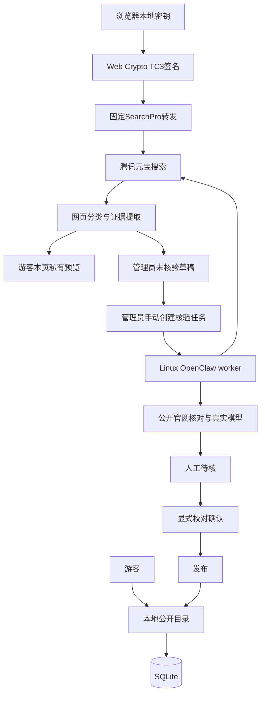

# 网站、搜索与审核

仅接收开发、计算机类比赛及技术实践征文。事件真实与产品范围是独立条件，普通学生作文/文学文化征文即使主题提到AI也不收录。在线筛选、来源导入、确认/发布及公开读取有范围检查；智能体先核对实际技术参赛任务，再核对名称、日期和来源。

普通`/search`、`/api/search`、`/contests`、`/api/contests`只查本地公开目录。联网搜索只有显式`/api/online-search`，每次转发一个短期签名请求，不加载服务端CAM、不执行网站模型。

## 审核状态

未核验包含原始、失败或变更后需重核条目；人工待核表示AI已完成但未确认；已核验表示当前事实已有显式校对。发布独立，只有校对有效且published才公开。

普通保存、发布、AI通过、来源解析均不自动等于人工确认。事实或主来源变更使旧确认失效；受托校对说明单独记录，不修改AI模型与实际运行时间。

## 事实和证据

正式赛名与原报道标题分开，来源、摘录及检索时间可追溯。启发式提取不是官方核验。完整截止按北京时间日历老化显示，不改源事实；缺年、非法日期和含糊区间不猜。

主办不能用媒体名兜底。线下国内/国外据真实举办地，不从域名、语言或机构推断。模型失败保留失败，缺字段可留空。

## 数据保护

管理端使用HttpOnly opaque会话，写操作做同源/CSRF校验；草稿、退役和删除记录不公开。删除进回收站可恢复，操作绑定版本指纹。

合并需证明同一届同一赛事，共享列表页不构成身份。人工合并先预览版本；保留独立决定跨任务保存。导入不覆盖已有、删除或退役记录。

发布源码按显式文件清单组装，排除运行时数据库、密钥、签名、模型临时工作区和运维备份。
