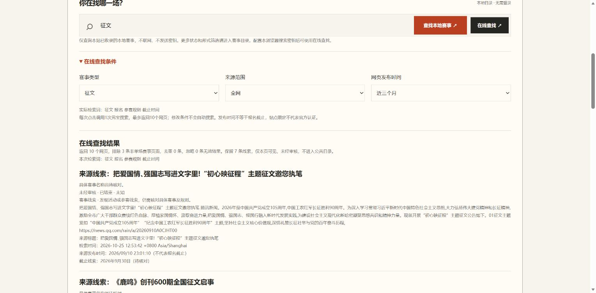

# 【元宝搜索开发者征文大赛】用元宝搜索搭建赛事通：从网页噪声到可复核的开发者赛历

项目源码：https://github.com/panda-lsy/saishi-tong  
体验网站：https://competition.shengxia.me/  
许可证：MIT。作品阶段：已上线服务。本文介绍0.2.2版本；真实搜索样本记录于2026年10月26日，自动化验证记录于2026年10月28日。本站仅收录开发、计算机类比赛及技术实践征文。

## 为什么做一个赛事网站

我经常想找适合自己的黑客松、征文和开发者挑战，却发现信息分散在社区活动页、主办方公告、新闻转载和技术博客里。搜索结果里有报名通知，也有获奖报道；同一场比赛有好几个标题，真正的提交截止和报名入口反而不容易找到。

因此，我做了“赛事通”：先用腾讯元宝搜索发现网页，再把线索整理成带来源、检索时间和审核状态的赛事目录。用户最终看到的是能继续核对的参赛信息，而不是一份貌似完整、却说不清出处的模型回答。

网站是主要演示入口。游客不需要账号或密钥就能查本地公开目录，按状态、参与形式和线下地区筛选；管理员维护事实、处理来源和审核。真实搜索与模型核验是可选的独立步骤，普通浏览不会悄悄消耗外部服务额度。

## 一次看似正常、实际很糟的搜索

最有帮助的反馈来自真实使用。输入“征文”，搜索返回了《征文是什么意思》《征文（汉语词语）》和征文格式范文。它们符合关键词相关性，却没有提供一场可报名的具体赛事。

早期程序又把问题放大了：只要搜索结果有标题和链接，就创建赛事草稿。一个解释页面被整理成“征文启事”，主办方正则从“主办者后”里截出“者后”。还有媒体站名被当成主办单位、落幕报道被混入报名线索的问题。

这让我意识到，搜索引擎负责找到相关网页，应用必须负责判断网页在自己的业务里意味着什么。把搜索结果直接包装成结构化卡片，并不会自然获得可靠的赛事数据。

## 元宝搜索如何接入

项目使用腾讯云WSA的SearchPro，API版本为2025-05-08。每次网页在线查找发出一次请求，最多展示十个网页，并提供网页时间范围与CSDN、魔搭来源范围选项。实际查询词在点击前可见，用户修改选项不会自动发起搜索。

参数大致如下，示例不包含凭据：

```json
{"Query":"征文 报名 参赛规则 截止时间","Cnt":10,"Mode":0,"Freshness":"m3"}
```

这是标准版或旗舰版的请求体示意。官方文档注明极速版不支持`Mode`和`Cnt`，因此账号开通极速版时，界面会省略这两个字段；这个选项只改变请求参数，不会切换腾讯云账号已开通的版本。接口成功响应中的`Version`可以显示实际版本，极速版没有动态摘要和相关性分值时，程序也能处理。

独立离线工具可用项目的SDK封装复现一次调用。下面示例需要先按README配置自己的权限；运行会消耗一次搜索额度，且不经过网站的浏览器签名链路：

```python
import json
from saishi_tong.client import search_pro
from saishi_tong.service import load_env_files

load_env_files()  # 仅加载本机允许的腾讯云配置字段
response = search_pro(
    "site:csdn.net 2026 开发者 征文 大赛 调用 API 源码 报名",
    cnt=10, mode=0, freshness="m3",
)
for item in response.get("Pages") or []:
    page = json.loads(item) if isinstance(item, str) else item
    print(page.get("title", ""), page.get("url", ""))
```

这个示例中的`site:csdn.net`是查询词文本，并非SearchPro的`Site`参数；若使用极速版，应省略不受支持的参数。生产应用还需要对无效JSON、空结果、来源URL和敏感内容做边界处理，完整实现见仓库。

SearchPro的Pages中，每个页面可能是JSON字符串；应用解析标题、URL、标准摘要passage、动态摘要content、发布时间和相关性分值。两种摘要都尽量保留在有界证据里，不能因为前两百字没有截止，就忽略后面的提交说明。

站点参数可以缩小范围，却不保证结果都是比赛。旗舰版在公开网页模式下可能附带权威垂类结果，而`Site`不会约束这些结果；因此选择CSDN或魔搭后，应用还会检查返回URL的真实域名，越界结果列出排除原因，不会进入管理员草稿。域名比较要求完全匹配或是子域名，`csdn.net.example`不能冒充`csdn.net`。

`Freshness`限制的是网页时间，也不是活动截止。官方示例中的`m3`覆盖本月及前两个月，`y1`覆盖本自然年，不应解释为最近90天或365天。最近发表的获奖报道完全可能对应已经结束的比赛。相关性`score`只反映搜索相关性，不能当作赛事真实性或可报名状态的置信度。

技术依据：[SearchPro官方文档](https://cloud.tencent.com/document/product/1806/121811)。

## 浏览器密钥与本地目录分开

设置页允许用户自愿保存当前浏览器的搜索密钥。点击在线查找时，SecretKey在Web Crypto中参与TC3签名计算；网站只接收短期签名请求，固定转发至腾讯SearchPro，不接收SecretKey，也不读取服务器CAM。

需要说明的是，这不是“密钥绝对安全”的承诺：localStorage本身是明文存储，受到同源脚本和浏览器扩展环境影响，因此我提供清除入口，并说明共享设备不应保存密钥。签名请求中临时包含SecretId，服务端不将它和签名落库或写入业务日志。

另一方面，网站普通搜索始终只查SQLite。游客即使没有配置任何密钥，也能使用公开目录；在线查询失败不会悄悄改用服务器密钥兜底。这让用户知道什么时候在读已有资料、什么时候会真正使用自己的搜索额度。

CLI和worker可以在各自受保护的主机读取自己的SearchPro配置。本次质量评估采用这个独立离线入口，不把它冒充浏览器真实操作；浏览器签名链路另有合成凭据、固定请求体和转发边界测试。

签名依据：[腾讯云TC3文档](https://cloud.tencent.com/document/api/213/30654)。

## 从“网页”到“赛事线索”的第一道门



图：2026年10月25日旧版网站的隔离回放，使用历史来源摘录。图中普通文化征文属于修复前的错误示例，不代表当前目录或本轮真实在线搜索。

现在程序在建卡前先做保守分类。明确的词义解释、范文、多个赛事的列表，以及魔搭的模型、数据集、技能资源页面不直接入赛事表；部分技术评测和参赛手记也会标明原因。用户可以展开查看被排除的标题、来源和检索时间。

对于缺少日期或正式名称的网页，我没有一律丢弃。它可能是一场真实赛事的简短预告，也可能只是弱相关信息，所以保持“待判断”，留在私有审核范围。正式名称不确定时显示“来源线索＋原标题”，不把新闻句子硬写成正式赛事名称。

主办字段也改为依据明确的机构表达，不能用媒体站名补空。截止提取补充了日期在前的写法，例如日期后接“结束征稿”；多个报名或提交日期冲突时宁可留空。评审、颁奖时间与报名截止分别处理，不能为了让卡片完整就挑一个日期填上去。

## 真实调用给出的结果和限制

2026年10月25日曾明确执行七次SearchPro评估请求。其中六次保存了可分析结果；一次初始CSDN查询在本地评估脚本解析阶段遇到TypeError，后续补充查询确认了成功响应也可能返回`Pages=null`。程序因此补充空结果兼容，避免把“没有网页”变成不明失败。以下是旧版本网页质量筛选记录，并非当前版本准确率。

| 样本 | 返回网页 | 规则排除 | 保留待核 |
| --- | ---: | ---: | ---: |
| 宽泛“征文” | 10 | 3 | 7 |
| 添加报名、规则、截止意图 | 10 | 0 | 10 |
| 魔搭站点的AI黑客松查询 | 10 | 9 | 1 |
| CSDN站点补充查询 | 0 | 0 | 0 |
| CSDN博客站点补充查询 | 10 | 9 | 1 |
| 魔搭站点简短活动查询 | 3 | 2 | 1 |

这组数字保留的是0.2.0仅按网页质量筛选的历史结果，尚未执行当前技术范围检查；宽泛征文中保留的普通文化作文并非本站可收录赛事。这张表不能作为当前版本收录效果的证明。

这里的“保留”不是准确率。魔搭会返回资源页，CSDN博客会返回工具评测，保留下来的不确定页面仍需审核；空结果也不能解释为该平台不存在赛事。这些查询没有构成大规模随机对照实验，不能宣称普遍提升了多少召回率。

对我来说，更有价值的结果是：应用现在能够如实说明网页去了哪里、为什么没有成为赛事，以及哪些信息还没有证据。它没有用更多自动请求把不确定性藏起来。

10月26日又在服务器的离线工具中实际执行过一次搜索：查询词为`site:csdn.net 2026 开发者 征文 大赛 调用 API 源码 报名`，返回10个网页，其中4个不属于CSDN域名。这次只是把`site:`写在查询词里，并没有设置接口的`Site`参数，因此不能把越界归因于接口忽略了严格站点条件。10个网页也不等于10场赛事：其中有综合活动介绍、教程和转载。

其中一个[鸿蒙共创季页面](https://harmonyosdev.csdn.net/6ab0fc8b05257b0857120b31.html)给出了进一步核查的入口。后来，管理员通过**另一个**来源采集任务提取具体活动，再通过**另一个**OpenClaw核验任务核对来源；工作端实际记录模型`openai/gpt-6-luna`。受托校对后，第一期“鸿蒙心迹·开发录”作为技术实践征文发布，保留了来源和截止线索。这个例子展示的是多个步骤组成的流程，并不是一次API请求自动完成审核，也不是浏览器签名链路的真实调用证明。

## 审核流程比“AI已核验”四个字重要

管理端分未核验、人工待核和已核验。管理员导入的新来源先是私有草稿；手动创建核验任务后，Linux上的OpenClaw worker读取任务，调用SearchPro、打开官网并使用实际模型核对，写回模型标识、时间、来源、缺失字段和结论。

AI通过仍然停在人工待核。只有显式校对确认当前事实，并将记录设为发布，游客才看得到。事实或主来源被修改后，旧确认失效；普通保存或单击发布不能绕过确认。

收尾时发生了一次收录错误：“第二十七届世界华人学生作文大赛”虽然有官方公告，也经过真实Luna事实核验，但它是普通作文赛事，不属于本站的开发、计算机类定位。助手把“事实真实”误当成“符合范围”并授权放行；用户指出后，已撤销该确认、撤下并移入可恢复回收站。该案例现在用于范围拒收回归，不作为本站的成功推荐案例。

来源：[官方赛程](https://www.zuowendasai.com/)、[官网公告](https://www.zuowendasai.com/shows/1/240.html)、[领馆通知](https://toronto.china-consulate.gov.cn/zytzxx/202608/t20260829_12012443.htm)。

授权不能代替范围判断。应用在搜索线索筛选、手动来源导入、管理员确认/发布及公开目录读取增加范围检查，并要求核验智能体先确认技术参赛任务。题目含AI、数智主题，不足以把文学作文或纯视频创作变成开发比赛；技术任务不明确的在线线索只留管理员私有待核。原始模型执行历史保留，撤销的是错误的收录放行决定。

## 目录和后台如何让信息更可用

发现页和公开目录只展示当前报名线索，已结束的赛事移入可恢复回收站。状态和参与形式支持多选，同组取并集、组间取交集，“全部”与具体选项互斥。选择线上或线下时也可匹配混合赛事；实际举办地证据不足时，国内/国外保留未知。

后台提供固定保存栏的编辑抽屉、日期选择、任务进度和回收站。删除只隐藏记录，恢复保留原事实和审核状态。重复合并先预览并绑定版本指纹，避免旧页面覆盖新内容；共享列表链接不能成为不同赛事自动合并的理由。

完整年份的截止日期按北京时间日历更新展示状态，原始事实不改；无年份、日期非法或区间模糊时不自动猜测。未来截止日期本身也不能证明报名已经开始：对于尚未核验的线索，系统还需要原文有“正在报名”等表达或覆盖当天的报名窗口；明确尚未开放的留待核。事实指纹不再匹配时，即使旧记录残留了确认时间，也不能进入已核验分组或公开结果。

## 复现、测试与诚实交付

网站使用Python、FastAPI、SQLite和原生前端。按README创建虚拟环境、安装依赖即可启动；新环境默认空库，不种入虚构赛事。公开浏览不依赖OpenClaw，模型worker另行配置，外部服务需要自己的权限与额度。

2026年10月28日的本地回归包含223项Python测试，以及前端DOM和独立TC3签名测试；部署前，两个运行节点的隔离副本也各通过223项测试。公开源码在全新Python 3.12环境安装后再次通过这些测试，并以空库、空用户目录和无服务密钥的配置启动，核对公开页面、本地搜索和未配置时关闭的管理入口。测试使用临时数据库和合成凭据，覆盖站点边界、极速版请求、草稿隔离、CSRF、审核事实指纹、删除恢复、报名时间和筛选语义；合成凭据不会被宣传为真实服务调用。源码按显式文件清单组装，排除生产数据库、私人草稿、密钥、Cookie和内部运维归档。

浏览器验证也有具体限制：10月25日做过真实桌面回放和手机布局测量；10月28日浏览器自动化多次超时，未完成当前版本桌面及手机像素复测。上面的旧版截图只能用于解释历史问题；发布文章前仍应补上当前版本运行截图。已有API和DOM测试不能代替这部分验收。

现阶段我选择把用户投稿、本人回执和云端搜索历史放到后续版本。先让“发现线索—核对出处—审核放行—本地查找”这条路径可解释、可复现，再扩展更多入口。

项目使用AI辅助编程、资料整理、草稿撰写和部分赛事核验；助手按授权进行人工等值校对并记录依据。实际搜索、模型记录、受托审核与工具限制分别说明；作者将对文章与结果进行事后复审。欢迎从源码和来源链接检查这些实现，而不是只相信一张结构化结果卡片。
